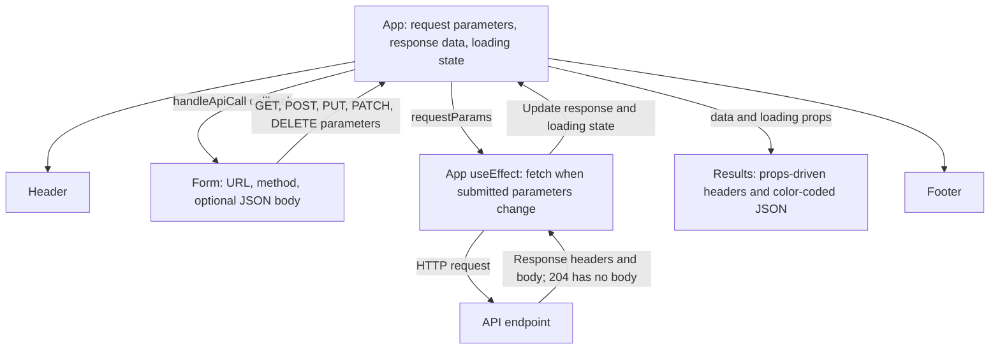

# RESTy — Lab 28 UML Diagram

POST, PUT, and PATCH support JSON request bodies. Results receives all data through props and displays HTTP 204 results as `null`.

During integration tests, MSW v2 intercepts HTTP requests. Automated coverage includes GET, POST, PATCH, and DELETE; PUT is supported by the application but is not covered by these tests.
